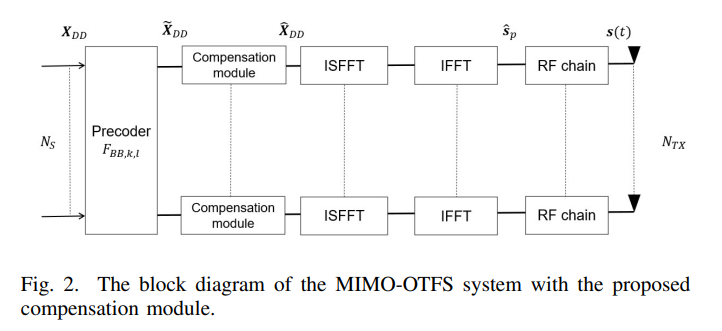
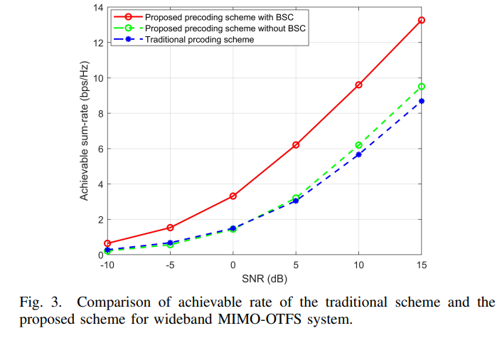
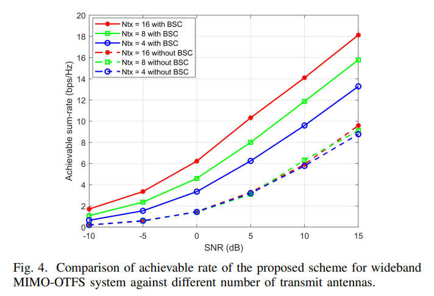

# [OTFS-MIMO]Beam Steering Effect of OTFS-MIMO System Precoding Design[with MATLAB Code]

The emerging orthogonal time-frequency space (OTFS) technology can achieve stable communication in high-speed moving scenarios, and its combination with multiple input multiple output (MIMO) can enhance the spectral and energy efficiency of wireless communication systems. To realize the potential performance gain of OTFS-MIMO systems, this paper investigates the precoding design for a wideband OTFS-MIMO system with beam skew effects. We propose a novel precoding structure with a compensation module to eliminate the impact of beam skew and further improve the reachable rate. Simulation results demonstrate that under our proposed scheme, the reachable rate of the wideband OTFS-MIMO system with beam skew is significantly improved.
Introduction The future sixth-generation wireless communication systems are expected to meet more complex and diverse application scenarios and higher performance requirements [1]. For example, high mobility scenarios with mobile speeds exceeding 500km/h, including drones and near-Earth orbit satellites. In such cases, high Doppler shift will destroy the orthogonality of subcarriers in multi-carrier communication systems, causing carrier-to-interference (CII) in traditional OFDM systems, leading to performance degradation. To address this issue, literature [2] proposed the Orthogonal Time-Frequency Space (OTFS) technology. OTFS achieves signal conversion from the time-frequency domain (TF domain) to the delay-Doppler domain (DD domain) through the Singular Finite Fourier Transform (SFFT) and its inverse transform (ISFFT), thereby converting the time-varying channel into an invariant channel in the DD domain, allowing data carrying information to be reused in the DD domain for stable communication in high-speed moving scenarios. Moreover, OTFS can be implemented by adding processing modules before and after existing multi-carrier modulation systems, thus being compatible with existing communication systems [3].
Multi-Input Multi-Output (MIMO) technology enhances the spectrum and energy efficiency of wireless communication systems, and its combination with OTFS can effectively improve the performance of high mobility systems [4], [5]. Precoding is an important component of the OTFS-MIMO system. By designing appropriate precoding, signals can match channel characteristics, fully utilizing the potential performance of the OTFS-MIMO system. Recent research has focused on the design of precoding for the OTFS-MIMO system [7]-[10]. Literature [7] demonstrates that the inverse of a large matrix can be calculated by its submatrix's inverse, based on which, a low complexity OTFS-MIMO precoding scheme was realized through submatrix inversion. Literature [8] proposed a maximum ratio transmission (MRT) precoding scheme to reduce the complexity of signal detection in multi-user (MU) OTFS-MIMO. Due to the separability of paths in the DD domain, literature [9] introduced a low complexity hybrid precoding scheme for MIMO-OTFS transmission, which allows symbols to be transmitted without interference and achieves near-optimal rate performance through power allocation per path. Literature [10] designed a Tomlinson-Harashima precoding (THP) scheme for MU OTFS-MIMO transmission, pre-eliminating DD domain interference in each symbol.
However, the above precoding schemes have not considered the beam-tilting effect in wideband systems. For narrowband systems, the impact of antenna arrays can be represented as constants related to antenna parameters, but in wideband systems, the antenna array affects different frequency components of signals differently, leading to severe array gain loss [11]. To address this issue, several methods have been proposed in traditional systems [12]-[14], but due to the complex convolution relationship between symbols and channels in the DD domain, most methods are not applicable to OTFS systems.
This paper investigates the precoding design for a broadband OTFS-MIMO system with beam-tilt effects. Firstly, we derive the system channel model that separates the beam-tilt impact from the DD domain channel; then, we propose a module to eliminate the beam-tilt effect in the DD domain; finally, we introduce a precoding algorithm to maximize the system reachable rate. Numerical results show that the reachable rate of the broadband OTFS-MIMO system with beam-tilt can be significantly improved after adopting our proposed scheme.
The article includes illustrations.
Conclusion This paper studies the broadband OTFS-MIMO system with beam-tilt effects and designs a precoding scheme with beam-tilt compensation. Specifically, we establish a time-varying channel model for the broadband OTFS-MIMO system with beam-tilt. Leveraging the separability between beam-tilt effects and the DD domain channel, we design a compensation module to eliminate the interference caused by beam-tilt, and then utilize the water-filling precoding scheme to maximize the reachable rate. Simulation results demonstrate that our proposed scheme can effectively improve the reachable rate of the broadband OTFS-MIMO system with beam-tilt.
End

## Images

<!-- PAYMENT_BLOCK -->

## Get this dataset

- Payment link (Stripe): [Buy now](https://buy.stripe.com/3cs8yP7sY87d0vu9AB)
- Payment QR code: 

<!-- /PAYMENT_BLOCK -->
